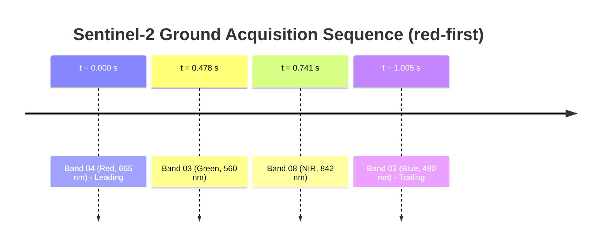
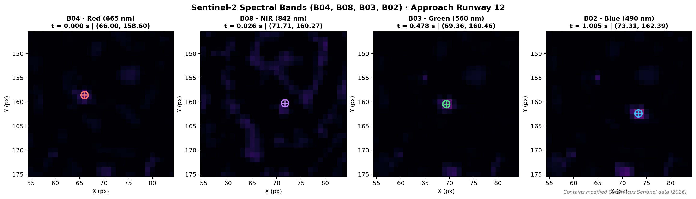
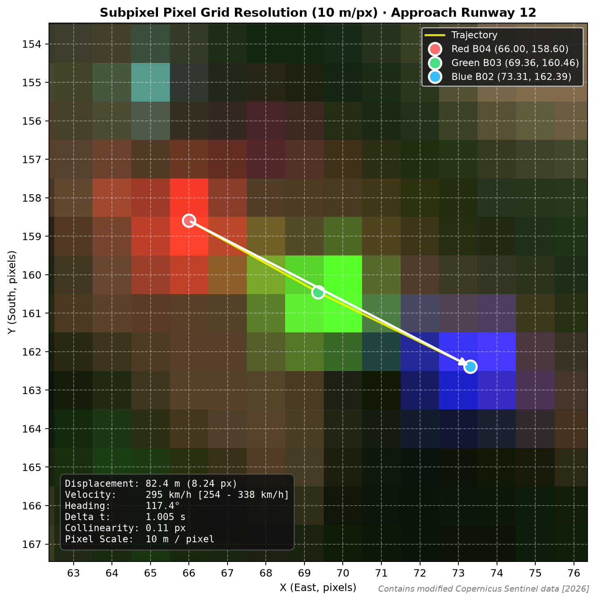
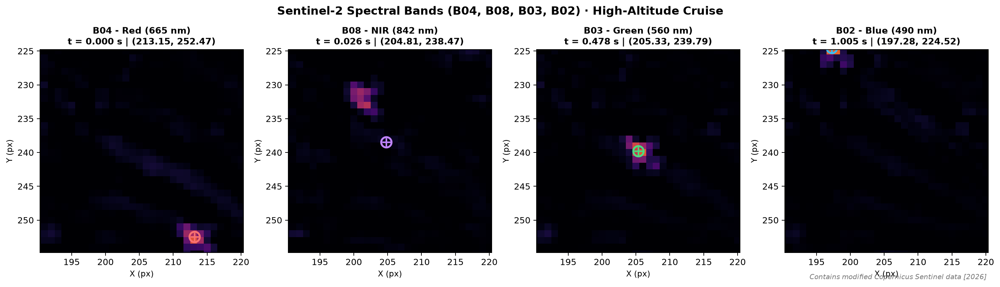
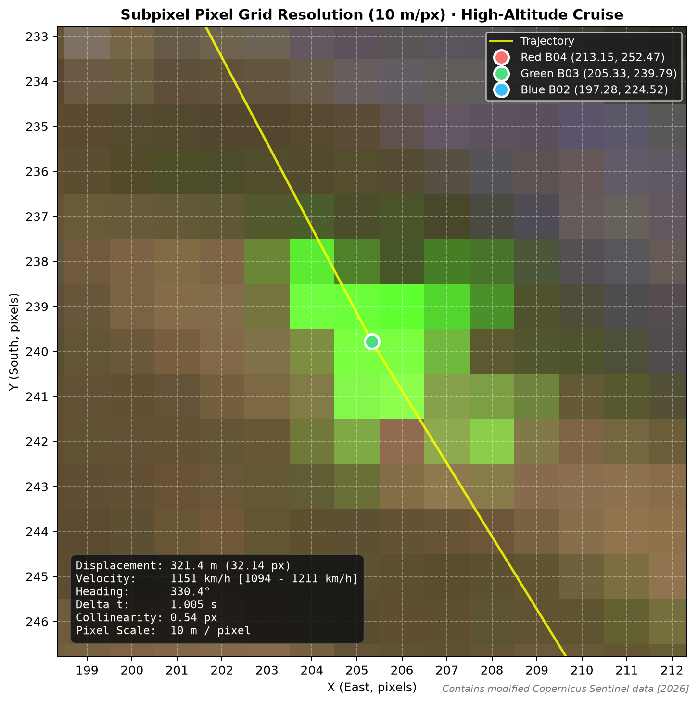

# Sentinel-2 Movement (`s2motion`)

[](https://github.com/alfredgabriel/sentinel2-movement/actions/workflows/ci.yml)
[](https://www.python.org/)
[](LICENSE)
[](https://github.com/astral-sh/ruff)

> **Detection, trajectory tracking, and velocity measurement of fast-moving surface objects using inter-band sub-second parallax in pushbroom Sentinel-2 imagery.**

*Read this documentation in Spanish: [README.es.md](README.es.md).*

---

## 1. What is this and why does it work?

The **MultiSpectral Instrument (MSI)** on board the European Space Agency's (ESA) **Sentinel-2** satellites is a **pushbroom sensor**. Unlike framing cameras that capture all spectral bands instantaneously, pushbroom sensors image the Earth via linear CCD detector arrays placed at slightly different along-track positions on the focal plane.

As Sentinel-2 orbits at $\sim 7.2 \text{ km/s}$ in a sun-synchronous descending orbit (North to South), the physical layout of the focal plane dictates the along-track scanning sequence:
- **Band 4 (Red)** is the leading detector in the flight direction: it images any ground coordinate **first** ($t = 0.000\text{ s}$).
### Physical Ground Acquisition Sequence
The inter-band time spacings ($0.000, 0.264, 0.527, 1.005\text{ s}$) are derived from scientific literature (Krauß 2021, Binet et al. 2022). The chronological direction (Red $\rightarrow$ Green $\rightarrow$ Blue) was established empirically from contrail orientation in Case 2 and aerodynamic velocity plausibility (detailed in [docs/band-order.md](docs/band-order.md)). Both `red-first` (default) and `blue-first` are supported via `--band-order`.

Under the default `red-first` sequence:
- **Band 4 (Red)** is the leading detector: it images a ground target **first** ($t = 0.000\text{ s}$).
- **Band 3 (Green)** follows $0.478\text{ s}$ later ($1.005 - 0.527\text{ s}$).
- **Band 8 (NIR)** follows $0.741\text{ s}$ later ($1.005 - 0.264\text{ s}$).
- **Band 2 (Blue)** is the trailing detector: it images the ground target **last** ($t = 1.005\text{ s}$).



| Band | Spectral Domain | Center Wavelength | Ground Acquisition Delay | Role |
|:---:|:---:|:---:|:---:|:---:|
| **B04** | Red | 665 nm | **0.000 s** | First exposure (Leading) |
| **B03** | Green | 560 nm | **0.478 s** | Intermediate exposure |
| **B08** | Near Infrared (NIR) | 842 nm | **0.741 s** | Intermediate exposure |
| **B02** | Blue | 490 nm | **1.005 s** | Final exposure (Trailing) |

### The Moving Object Signature
When an object travels at high speed during this $\sim 1.005 \text{ s}$ window (such as an aircraft on approach or in flight), it advances along its trajectory between sequential exposures. In an RGB composite (Red=B04, Green=B03, Blue=B02), this manifests as **three distinctly colored spots in a collinear row pointing in the direction of motion**:
$$\mathbf{Red} \longrightarrow \mathbf{Green} \longrightarrow \mathbf{Blue}$$

By estimating the **subpixel centroid** in each band, `s2motion` determines:
1. **Displacement vector** ($\text{Red} \to \text{Blue}$ or $\text{Blue} \to \text{Red}$) and ground distance in meters.
2. **True geographic heading** ($0^\circ = \text{North}$, clockwise, $90^\circ = \text{East}$, $180^\circ = \text{South}$, $270^\circ = \text{West}$).
3. **Ground velocity** with propagated uncertainty bounds.
4. **Georeferenced proximity to aerodrome runways**: Distance to closest threshold, distance along extended runway axis, and perpendicular offset from the centerline with explicit spatial uncertainty ($\approx \pm 15\text{ m}$).
5. **Coherence diagnostics**: Collinearity offset of the Green detection and temporal projection consistency.
6. **Environmental Surface Weather**: Queries historical surface weather (Open-Meteo / ERA5 reanalysis) linearly interpolated to the scene timestamp for environmental context.

---

## 2. Installation

Requires Python $\ge 3.10$.

```bash
# Clone the repository
git clone https://github.com/alfredgabriel/sentinel2-movement.git
cd sentinel2-movement

# Create and activate a virtual environment
python -m venv .venv
source .venv/bin/activate  # On Windows: .venv\Scripts\activate

# Install the package with dependencies
pip install -e .

# Optional: install development tools (pytest, ruff)
pip install -e ".[dev]"
```

---

## 3. Quick Start (3 Commands)

```bash
# 1. Download windowed RGB crops over Bilbao Airport (cloud cover < 10%)
s2motion crops --start 2026-08-01 --end 2026-08-15 --max-cloud 10 --out outputs/

# 2. Inspect a scene interactively to locate coordinate seeds (click logs x, y)
s2motion view --config examples/loiu_2026-08-12.toml

# 3. Detect subpixel centroids, calculate velocity, and export publication figure with weather telemetry
s2motion measure --config examples/loiu_2026-08-12.toml --weather

# 4. (Optional) Validate kinematics against external ADS-B state vectors offline
s2motion validate --adsb flight_data.csv --config examples/loiu_2026-08-12.toml
```

---

## 4. Case Studies & Results

### Case 1: Aircraft on Approach to Runway 12, Bilbao Airport (2026-08-12)
- **Target**: Fast-moving aircraft aligned with runway 12 at Bilbao Airport (LEBB/BIO) (working hypothesis: short final approach under `red-first`, pending ADS-B confirmation).
- **Physical & Spatial Context**:
  - Bilbao Airport Runway 12/30 threshold coordinates from [ENAIRE AIP España (AD 2-LEBB)](https://aip.enaire.es/AIP/):
    - **THR 12 (NW)**: `43°18'22.85"N, 002°55'29.78"W` (`43.306347°N, -2.924939°W`)
    - **THR 30 (SE)**: `43°17'45.91"N, 002°53'49.02"W` (`43.296086°N, -2.896950°W`)
    - True forward geodetic axis calculated from thresholds: **$116.7^\circ$** (the nominal designation '12' is rounded to $120^\circ$).
  - **Georeferenced Position**: The detected aircraft (Red centroid) is located at **$43.310770^\circ\text{N}, -2.936874^\circ\text{W}$** (estimated absolute position uncertainty $\approx \pm 25\text{ m}$ at $\sim 2\sigma$ considering the global absolute geolocation specification without GCPs of $20\text{ m}$ at $2\sigma$ per [ESA eoPortal](https://earth.esa.int/eoportal/satellite-missions/c-missions/sentinel-2), $10\text{ m/px}$ resolution, and motion during the scan), approximately **$1085 \pm 25\text{ m}$ northwest of Threshold 12** along the extended runway centerline ($-1085 \pm 25\text{ m}$ along track) and **$5.0 \pm 25.0\text{ m}$ off the extended centerline**.
  - **Status**: The aircraft is not on the runway surface (`is_on_runway: False`), but positioned in the straight-in approach corridor with heading **$117.4^\circ \pm 7.0^\circ$**, differing by **$0.7^\circ (\pm 7.0^\circ)$** from the runway 12 geodetic axis.

#### Full Scene Overview (Uncropped Crop of Bilbao Airport Area)


#### Subpixel Kinematics & Inter-Band Analysis (with Live Weather Fusion)


#### Multi-Band Spectral Anomaly Panels (B04, B08, B03, B02)


#### High-Zoom Subpixel Resolution with Pixel Grid (10 m/px)


```text
============================================================
Sentinel-2 Moving Object Kinematics & Coherence Report
============================================================
Direction:    Red -> Green -> Blue
Distance:     82.4 m (range: 72.4 - 92.4 m, 1-sigma: +/-7.1 m)
Heading:      117.4 deg clockwise from North (+/-7.0 deg)
Velocity:     295 km/h (range: 254 - 338 km/h) [82.0 m/s]
Delta t:      1.005 s (range: 0.985 - 1.025 s)
------------------------------------------------------------
Coherence Diagnostics:
  - Green collinearity offset: 0.11 px (expected < ~1.0 px)
  - Green relative position:  0.47 (expected: 0.48, delta: 0.01)
  - Runway axis difference:   0.7 deg (+/-7.0 deg)
------------------------------------------------------------
Runway Position (LEBB Runway 12/30, axis 116.7°):
  - Reference Centroid:     Red band (estimated spatial uncertainty: ±25 m, ~2σ)
  - Geodetic Coordinates:   lat 43.310770°, lon -2.936874° (±25 m)
  - Proximity to THR 12:    1085 ± 25 m (along extended axis: -1085 ± 25 m)
  - Centerline Offset:      5.0 ± 25.0 m
  - Status:                 APPROACH CORRIDOR (1085 ± 25 m before THR 12) [on runway surface: False]
------------------------------------------------------------
Surface Weather Telemetry (Open-Meteo, 10m AGL - Environmental Context):
  - Surface Weather:  28.9 °C | 1014.4 hPa | Wind 10.6 km/h (5.7 kt) from 14°
  - Wind Components:  Headwind: -2.4 km/h (-1.3 kt) | Crosswind: -10.3 km/h
  - Note:             Surface wind does not imply physical causality for aircraft ground speed.
============================================================
```

**Physical & Kinematic Interpretation**:
- **Flight phase hypothesis**: Ground speed of **$295 \text{ km/h}$** ($82.0 \text{ m/s}$ / $159\text{ kt}$) and geographic heading of **$117.4^\circ \pm 7.0^\circ$** at $1085 \pm 15\text{ m}$ before Threshold 12 are consistent with a commercial jet on short final approach to runway 12 under the `red-first` band order. Note that under `blue-first`, the same geometry corresponds to an initial climb out after departure from Runway 30 ($297.4^\circ \pm 7.0^\circ$). Without external ADS-B state vectors (active runway at ~11:09 UTC), this remains an unvalidated operational hypothesis (see [docs/band-order.md](docs/band-order.md)).
- **Runway axis alignment**: The measured heading ($117.4^\circ \pm 7.0^\circ$) differs by **$0.7^\circ (\pm 7.0^\circ)$** from the geodetic runway axis ($116.7^\circ$) calculated directly from official ENAIRE AIP threshold coordinates.
- **Surface meteorological context**: Historical Open-Meteo reanalysis (interpolated to the product sensing start time $11:09:40\text{ UTC}$, noting that target overpass may differ by a few seconds) shows ground-level temperature of $28.9^\circ\text{C}$, QNH $1014.4\text{ hPa}$, and a surface wind of $10.6\text{ km/h}$ from $014^\circ$. These values describe the local surface atmosphere at 10 m AGL as environmental context without causal interpretation.

---

### Case 2: High-Altitude Cruising Aircraft with Contrail (2026-06-21)
- **Target**: Aircraft at cruising altitude ($\sim 10 - 11 \text{ km}$) heading northwest across the Bilbao region, with a prominent condensation trail (contrail).

#### Full Scene Overview (Bilbao Region with Visible Contrail)


#### Subpixel Kinematics & Inter-Band Analysis


#### Multi-Band Spectral Anomaly Panels (B04, B08, B03, B02)


#### High-Zoom Subpixel Resolution with Pixel Grid (10 m/px)


```text
============================================================
Sentinel-2 Moving Object Kinematics & Coherence Report
============================================================
Direction:    Red -> Green -> Blue
Distance:     321.4 m (range: 311.4 - 331.4 m, 1-sigma: +/-7.1 m)
Heading:      330.4 deg clockwise from North (+/-1.8 deg)
Velocity:     1151 km/h (range: 1094 - 1211 km/h) [319.8 m/s]
Delta t:      1.005 s (range: 0.985 - 1.025 s)
------------------------------------------------------------
Coherence Diagnostics:
  - Green collinearity offset: 0.54 px (expected < ~1.0 px)
  - Green relative position:  0.46 (expected: 0.48, delta: 0.01)
------------------------------------------------------------
Stereoscopic Parallax Correction (Satellite Track: 6721 m/s, heading: 194.7°):
  - Target Altitude:          10500 m (range: 9000 - 12000 m)
  - Disclaimer:               Flight altitude is a user-specified parameter, not an independently measured observable.
  - Parallax Shift:           90.2 m along satellite track (323 km/h apparent contribution)
  - Apparent Velocity:        1151 km/h [319.8 m/s] | Heading: 330.4°
  - Parallax-Corrected Vel:   932 km/h [259.0 m/s] (range: 907 - 960 km/h) | Heading: 316.4° [-219 km/h vs apparent]
============================================================
```

**Interpretation & Stereoscopic Parallax Resolution**:
- **Apparent Ground Speed**: The uncorrected apparent speed is **$1151\text{ km/h}$** ($319.8\text{ m/s}$), which appears anomalously high for subsonic civil air transports.
- **Physical Cause**: For an airborne object at cruising altitude, the observed inter-band displacement combines true horizontal aircraft movement and stereoscopic parallax induced by the satellite ground track displacement ($v_{\text{track}} \approx 6.72\text{ km/s}$, heading $\approx 194.7^\circ$, derived from orbital mechanics).
- > [!CAUTION]
  > **Flight Altitude Disclaimer**: Flight altitude is a user-specified parameter, not an independently measured observable. Nominal cruise altitude is assumed at $h = 10.5\text{ km}$ ($34,450\text{ ft}$), with a plausible cruise altitude interval of $[9.0, 12.0]\text{ km}$ ($29,500 - 39,400\text{ ft}$).
- **Comparison of Band Order Hypotheses**:
  - **Under `red-first` (default)**: The aircraft moves northwest ($330.4^\circ$), counter to the southward satellite ground track ($194.7^\circ$). Correcting for forward parallax with the complete model ($\vec{v}_{\text{real}} = (1 - h/H)\vec{v}_{\text{apparent}} + (h/H)\vec{v}_{\text{track}}$, which differs by $\approx 15\text{ km/h}$ at $h = 10.5\text{ km}$ from the linear approximation) reduces the true horizontal speed:
    - Nominal $h = 10.5\text{ km}$: **$v_{\text{true}} = 932\text{ km/h}$** ($259.0\text{ m/s}$), true heading **$316.4^\circ$** ($\Delta v = -219\text{ km/h}$ vs apparent).
    - Cruise interval $[9.0, 12.0]\text{ km}$: **$v_{\text{true}} \in [907, 960]\text{ km/h}$** ($\approx 907 - 960\text{ km/h}$). This ground speed is compatible with commercial jet airliner cruise; wind at flight altitude is unknown.
  - **Under `blue-first` (counter-hypothesis)**: Reversing the time vector yields an apparent heading of $150.4^\circ$ (southeast, co-directional with the satellite track). The parallax correction reinforces the velocity:
    - Nominal $h = 10.5\text{ km}$: **$v_{\text{true}} = 1386\text{ km/h}$** ($385.0\text{ m/s}$), true heading **$159.8^\circ$** ($\Delta v = +234\text{ km/h}$).
    - Cruise interval $[9.0, 12.0]\text{ km}$: **$v_{\text{true}} \in [1350, 1422]\text{ km/h}$** ($\approx 1350 - 1422\text{ km/h}$). Corresponds to supersonic ground speed, which is physically implausible for civil commercial air transport.
- For complete mathematical derivations and orbital ground-track formulations, see [docs/method.md](docs/method.md) and [docs/band-order.md](docs/band-order.md).

---

## 5. Method Summary

1. **Remote Cloud-Optimized GeoTIFF (COG) Windowing**: Queries AWS Earth Search STAC (`sentinel-2-l2a`) and reads only the target bounding box via `rasterio.windows.from_bounds` without downloading full multi-gigabyte scenes.
2. **Local Anomaly Extraction**: Subtracts a $9 \times 9$ median filter background to eliminate runway markings and static surface features.
3. **Intensity-Weighted Subpixel Centroid**: Evaluates the center of mass of pixels $\ge 50\%$ peak intensity within a $3\text{ px}$ radius.
4. **Vector Kinematics**: Computes displacement from Red ($t=0.000\text{ s}$) to Blue ($t=1.005\text{ s}$), heading, and ground velocity.
5. **Rigorous Uncertainty Propagation**:
   - Accounts for $\pm 0.5\text{ px}$ subpixel localization error per endpoint.
   - **Absolute Georeferenced Positioning Uncertainty**: When comparing georeferenced pixel coordinates against external absolute aeronautical cartography (official ENAIRE AIP threshold coordinates), the applicable specification is the global absolute geolocation accuracy without GCPs (<20 m at 2σ / 95.5% on WGS84 per [ESA eoPortal](https://earth.esa.int/eoportal/satellite-missions/c-missions/sentinel-2)), not the 4.5 m multi-temporal co-registration specification (which applies strictly to relative alignment between successive scenes refined with the GRI per [Copernicus SentiWiki](https://sentiwiki.copernicus.eu/web/s2-geometric-data-quality)). Adding in quadrature the absolute geolocation specification (20 m at 2σ), subpixel centroid uncertainty (±0.5 px ⟹ 10 m at 2σ), and target movement during line scanning (~10 m at 2σ):
     $$\sigma_{\text{pos, abs}} = \sqrt{20^2 + 10^2 + 10^2} = \sqrt{600} \approx 24.5\text{ m} \approx \pm 25\text{ m} \text{ (at } \sim 2\sigma \text{ / } 95\%)$$
     Consequently, absolute positions relative to the runway threshold and centerline are reported as $1085 \pm 25\text{ m}$ and $5.0 \pm 25.0\text{ m}$ at $\sim 2\sigma$.
   - Incorporates $\pm 2\%$ timing variation in $\Delta t$ resulting from optical distortion and satellite altitude perturbations ([Binet et al., 2022](https://doi.org/10.5194/isprs-annals-V-1-2022-57-2022)).
   - Always reports velocity as an explicit interval $[v_{\min}, v_{\max}]$, never as an isolated point value.
6. **Atmospheric Environmental Telemetry**: Queries Open-Meteo reanalysis to document local surface ambient temperature, pressure, and 10 m AGL wind speed/direction for environmental context.
7. **Stereoscopic Parallax Correction for Airborne Targets**: Models along-track look angle separation between spectral bands using orbital ground-track velocity ($v_{\text{track}} \approx 6.72\text{ km/s}$ derived from orbital mechanics) to correct apparent aircraft velocities at user-specified cruise altitudes.

*For full mathematical derivations, see [docs/method.md](docs/method.md).*

---

## 6. Reproducible Figure Generation & Social Cards (4:5)

All scene overviews, detailed kinematics figures, multiband spectral panels, pixel grid zooms, and 4:5 social cards can be regenerated with a single command from offline data fixtures in `examples/data/` without network access:

```bash
# Generate all figures in Spanish (default)
python scripts/generate_figures.py --lang es

# Generate all figures with English text on social cards
python scripts/generate_figures.py --lang en
```

High-impact social media cards (1080x1350 px, 4:5 vertical) formatted for technical dissemination on LinkedIn/Twitter are exported to `docs/img/social/`:
- **Possible Approach Case 1**: `docs/img/social/case1_approach_4x5.png` (Speed: $295 \pm 42\text{ km/h}$, Heading: $117.4^\circ \pm 7.0^\circ$, Runway offset: $5.0 \pm 25.0\text{ m}$, disclaimer: *"sin validar con datos externos"*).
- **Cruise Case 2**: `docs/img/social/case2_cruise_4x5.png` (Parallax-corrected: $932\text{ km/h}$ $[907 - 960]$, Heading: $316.4^\circ \pm 6.1^\circ$, apparent vs corrected, disclaimer: *"sin validar con datos externos"*).

---

## 7. Validation Status

To maintain strict scientific transparency, the physical and kinematic components of `s2motion` are categorized according to their empirical backing:

| Component / Magnitude | Validation Status | Evidence / Technical Basis |
| :--- | :--- | :--- |
| **Inter-band timing ($0.000, 0.478, 1.005\text{ s}$)** | **Respaldada por literatura** | Official MSI focal plane detector staggered layout and empirical timing calibrations ([Krauß, 2021](https://doi.org/10.5194/isprs-annals-V-1-2021-17-2021); [Binet et al., 2022](https://doi.org/10.5194/isprs-annals-V-1-2022-57-2022)). |
| **Subpixel collinearity & Green position** | **Coherente internamente** | Observed offsets $\le 0.54\text{ px}$ and relative position delta $\le 0.01$ conform to uniform linear motion across detectors. |
| **LEBB Runway 12 geodetic alignment** | **Coherente internamente** | Compatible within uncertainty (±7°); alignment is symmetric with respect to the runway axis and does not discriminate band order. |
| **Stereoscopic pushbroom parallax model** | **Respaldada por literatura** | Derived from pushbroom geometry; magnitude consistent with literature (Krauß 2021, Heiselberg & Heiselberg 2021); sign not independently validated. |
| **Band acquisition order (`red-first`)** | **Hipótesis no validada** | The plausibility argument only applies to Case 2 (corrected speed 932 vs 1386 km/h) and depends on assumed altitude and unknown wind; pending ADS-B. |
| **Case 1 & Case 2 aircraft flight correlation** | **Pendiente de contraste ADS-B** | A priori criteria registered in [docs/validation.md](docs/validation.md); pending correlation with external ADS-B / Mode-S state vectors. |

---

## 8. Limitations

To ensure scientific honesty and transparency, the following physical and sensor constraints must be acknowledged:

1. **Manual Candidate Selection**: Analyzed detections were selected manually among observable candidates in the scene without an estimate of the false positive rate (FPR) in systematic or unsupervised searches.
2. **Collinearity as Internal Coherence**: Subpixel collinearity and the intermediate position of the green band diagnose internal consistency with a uniform rectilinear motion model across detectors, not an independent empirical validation.
3. **Altitude Parallax Conflation**: For airborne targets, apparent displacement is the vector sum of horizontal aircraft ground movement and stereoscopic parallax induced by satellite motion at high altitude. Velocity measurements are only strictly quantitative for targets on or very near ground level.
4. **Lack of Flight Identification**: Satellite imagery does not transmit aircraft callsigns, transponder codes, or flight levels. Correlating detections with specific commercial flights requires ADS-B telemetry validation.
5. **Sensor Spatial Resolution**: At $10\text{ m/pixel}$, an airliner spans only $3 - 5$ pixels. Structural details (wings, engines, fuselage shape) cannot be resolved; identification relies entirely on chromatic dispersion signatures.
6. **Slow-Moving Targets**: Ships and maritime vessels moving at $10 - 20\text{ knots}$ ($5 - 10\text{ m/s}$) displace less than $5 - 10\text{ m}$ in $1.005\text{ s}$, which is near or below the single-pixel limit ($10\text{ m}$), making them challenging to quantify without multi-temporal cross-correlation.

---

## 9. Roadmap

Planned future extensions (not implemented in v0.2):
- [ ] **Automated Runway Swath Scanner**: Unsupervised detection of bright multi-chromatic anomalies along runway corridors with automated CSV reporting.
- [x] **ADS-B Telemetry Integration**: Offline validation module against OpenSky CSV and ADS-B Exchange JSON trajectories (see [docs/validation.md](docs/validation.md)).
- [ ] **Maritime Port Detection**: Adapted subpixel phase correlation for container ships and ferries entering the Port of Bilbao (El Abra).
- [ ] **20-Meter Band Expansion**: Inclusion of Red Edge (B8A) and Shortwave Infrared (B11, B12) detectors with their corresponding time lags.

---

## 10. Scientific References

- **Krauß, T. (2021)**. *Extraction of Cloud Heights from Sentinel-2 Multispectral Images*.  
  ISPRS Annals of the Photogrammetry, Remote Sensing and Spatial Information Sciences, Vol. V-1-2021, pp. 17–23.  
  DOI: [10.5194/isprs-annals-V-1-2021-17-2021](https://doi.org/10.5194/isprs-annals-V-1-2021-17-2021)
- **Binet, R., Bergsma, E., & Poulain, V. (2022)**. *Accurate Sentinel-2 Inter-Band Time Delays*.  
  ISPRS Annals of the Photogrammetry, Remote Sensing and Spatial Information Sciences, Vol. V-1-2022, pp. 57–66.  
  DOI: [10.5194/isprs-annals-V-1-2022-57-2022](https://doi.org/10.5194/isprs-annals-V-1-2022-57-2022)
- **Heiselberg, H. (2019)**. *Aircraft and Ship Velocity Determination in Sentinel-2 Multispectral Images*.  
  Sensors, 19(13), 2873. DOI: [10.3390/s19132873](https://doi.org/10.3390/s19132873)
- **Heiselberg, P., & Heiselberg, H. (2021)**. *Aircraft Detection above Clouds by Sentinel-2 MSI Parallax*.  
  Remote Sensing, 13(15), 3016. DOI: [10.3390/rs13153016](https://doi.org/10.3390/rs13153016)
- **European Space Agency (ESA)**. *Copernicus Sentinel-2 Mission Specification and Data Quality*.  
  [ESA eoPortal Sentinel-2](https://earth.esa.int/eoportal/satellite-missions/c-missions/sentinel-2); [Copernicus SentiWiki - Geometric Data Quality](https://sentiwiki.copernicus.eu/web/s2-geometric-data-quality). *(TODO: verify direct permanent public URLs for ESA internal document codes S2-RS-ESA-SY-0001 and ESA-EOPG-EOQC-RP-0001 once officially published)*.

---

## 11. Data Attribution & License

- **Copernicus Sentinel Data Attribution**: Contains modified Copernicus Sentinel data [2026].
- **Code License**: This project is licensed under the [MIT License](LICENSE).

